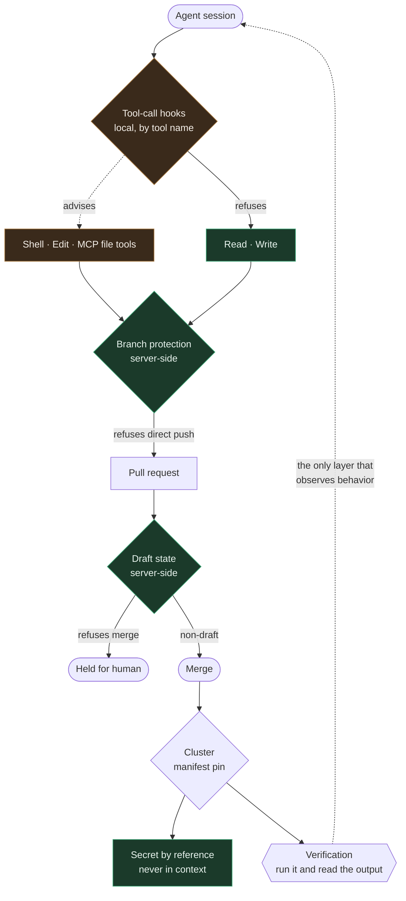

import Callout from '../../components/Callout.astro';
import PullQuote from '../../components/PullQuote.astro';
import SectionLabel from '../../components/SectionLabel.astro';
import DiagramBlock from '../../components/DiagramBlock.astro';
import StatRow from '../../components/StatRow.astro';

In August I published three pieces arguing that Zero Trust maps cleanly onto agentic systems: [the NIST SP 800-207 mapping](/analysis/zt-ai-systems), [dual-intent runtime authorization](/research/dira-framework), and [non-human identity for agents](/research/nhi-agentic). Agents are subjects. Tools are resources. The model holds up.

This is the implementation, and the implementation is where it gets interesting, because the architecture was never the hard part. The hard part is that an architecture diagram cannot tell you which of its boxes refuses anything.

So I sorted them. Every control in this stack, into two piles: the ones that refuse an action server-side regardless of who is asking, and the ones that are advice an agent is expected to follow. Six candidates. Two bind. One binds for a narrower question than it appears to. Three are advice, and one of those three had quietly stopped being reachable at all.

---

<SectionLabel text="The System" />

## What is actually running

Nine concurrent autonomous agent sessions on one host, each with its own terminal slot, working a shared issue tracker against roughly a hundred private repositories and an eight node Kubernetes cluster. They open pull requests, merge them, deploy manifests, read secrets through a secret manager, and modify the instruction files that govern their own behavior. One of them is an orchestrator that dispatches the others.

<StatRow stats={[
  { value: '9', label: 'concurrent agent sessions' },
  { value: '1', label: 'git identity between them' },
  { value: '0', label: 'required approving reviews' },
]} />

That middle number is the whole threat model. Nine sessions, plus the human, plus an automation bot, all authenticate to the forge as the same account. This is not laziness. It is what you get when every actor is an instance of the same tool holding the same credential, and it is the default shape of every agent fleet I have seen.

<Callout variant="insight" label="The consequence">
With one identity shared across every actor, the forge's own actor fields cannot tell you who did anything. The account name on a commit status is the same whether the human posted it, the bot posted it, or any of nine sessions posted it. Attribution has to come from the acting system's own log, or it does not exist.
</Callout>

---

<SectionLabel text="Threat Model" />

## STRIDE, and which rows are real here

STRIDE is the right starting point and the wrong stopping point, because the categories have very different weights once every subject is maximally privileged and indistinguishable from every other subject.

| Category | In this stack | Weight |
|---|---|---|
| Spoofing | One identity for every actor. Nothing to spoof, because nothing is distinguished in the first place. | Collapsed |
| Tampering | Agents write their own instruction files, their own CI gates, and the manifests that pin their own images. | High |
| Repudiation | No actor field can separate nine sessions, a bot and a human. Every action is deniable by construction. | **Dominant** |
| Information disclosure | Secrets reach workloads by reference. Values entering an agent's context window is the real exposure, not the store. | High |
| Denial of service | A prune holding an exclusive repository lock blocks every other backup leg for hours. Self-inflicted, not adversarial. | Medium |
| Elevation of privilege | There is nothing to elevate to. Every session starts with the maximum. | Collapsed |

Two rows collapsed and one became dominant. That reordering is the part that does not transfer from the enterprise threat models this vocabulary was built for, where spoofing and elevation are the main event because subjects are many and privileges are tiered. Invert both of those and you get a system where the question is never "could an attacker become an admin" but "when this goes wrong, will anything be able to say which actor did it, and will anything have refused".

<PullQuote>
The dominant threat in a single-identity agent fleet is not an intruder. It is a correct actor operating on a wrong premise, with no record that separates it from the eight others.
</PullQuote>

The adversary that matters most here is not an external attacker at all. It is an agent acting in good faith on a stale number, a renamed anchor, or a status field that lagged. I have a running count of those in this system and it is in the sixties. Not one of them involved a hostile party.

---

<SectionLabel text="Architecture" />

## Where the policy enforcement points actually sit

Mapping to the 800-207 vocabulary: the agent session is the subject, the tool call is the request, and there is no single policy decision point. There are five, at different layers, and they do not know about each other.

<DiagramBlock caption="Five enforcement layers between an agent's intent and a durable change. Solid edges refuse. Dashed edges advise.">

</DiagramBlock>

---

<SectionLabel text="The Sort" />

## What binds

**1. Branch protection, with admin enforcement on.** Direct pushes to the default branch are refused for every actor including the account that owns the repository. This is the one control I trust most, and I trust it because I reproduced the refusal rather than reading the configuration back:

```
$ git push origin HEAD:main
remote: error: GH006: Protected branch update failed for refs/heads/main.
remote: - Changes must be made through a pull request.
 ! [remote rejected]   HEAD -> main (protected branch hook declined)
```

Reading the protection endpoint would have told me the same thing and would have been worth less. A configuration endpoint reports intent. A rejected push reports behavior.

**2. Draft state on a pull request.** This is the only refusal in the stack that binds an agent's own merge command. A policy saying "do not merge this" is a sentence. Draft is a server-side no that the forge returns to every actor, including the session that opened the pull request, including the orchestrator, including the automation. Undrafting is therefore the approval action, and it belongs to exactly one pair of hands.

**3. Secrets by reference.** Credentials reach workloads as environment references resolved by the platform, not as values passed through an agent. This is the control that actually addresses the information disclosure row, and it works because of what it makes impossible rather than what it forbids: a value that never enters a context window cannot be logged, summarized, committed or recalled later. Scoping at the secret store is the backstop, and the standing discipline is to handle names and paths only.

---

<SectionLabel text="The Sort" />

## What reads as a control and is not

**4. A required pull request is not a required review.** The approving-review count on these repositories is zero, deliberately. It has to be: the forge forbids self-approval, and every actor shares one account, so any non-zero requirement deadlocks every automated merge in the system. A session can open a pull request and merge it itself seconds later.

<Callout variant="warning" label="State this precisely">
The pull request requirement buys a durable trail and a chokepoint. It does not buy a second pair of eyes, and describing it as review is the kind of error that gets written into a control inventory and never re-examined. The ceiling here is structural: a second reviewer requires a second identity, and that identity does not exist yet.
</Callout>

**5. A tool-call hook that matches on tool name.** The local hook that guards credential file paths matches on the name of the tool making the call, and only two of the file-touching tools are in its matcher. Every shell invocation passes through ungated, as do several other paths to the same bytes.

The clearest demonstration of this was accidental. The session testing the hook could not create its test file with the tool the hook watches, because that tool is watched. So it used the shell instead. The shell was not watched. The gate's own tester routed around it without noticing it had.

This is a documented and deliberately accepted state, not a bug waiting for a fix, and the reasoning is worth more than the gap: widening the matcher to the shell means pattern-matching arbitrary command strings for path references, across every shell call in nine concurrent sessions, and any indirection at all defeats it. A variable, a pipe, a script. The cost is continuous and the coverage gained is thin.

So it is a guard against an accidental read, and nothing in this system gets relaxed because it exists. The lesson generalizes past this one hook: **a matcher keyed on tool name is not a boundary around a resource.** If the thing you are protecting is a path, the enforcement has to live at the path, which here means scoping at the secret store and reference-based injection, not a name list at the call site.

**6. Scope instructions in a dispatch prompt.** When the orchestrator dispatches a subagent, the prompt carries explicit scope blocks: these files, these repositories, stop if you encounter anything else. Useful, and followed in practice. Not a sandbox. A declared permission mode does not reliably bind, and the allowed-tools list replaces session rules rather than intersecting with them, which means a narrower-looking declaration can be wider in effect. These blocks are a convention, and the system's own documentation now says so in those words, because the failure mode of a convention described as a sandbox is that it gets counted as coverage in a review.

For the same reason, a client-side pre-push hook is not enforcement. One flag skips it.

---

<SectionLabel text="The Interesting One" />

## A rule can stop being reachable without becoming wrong

The sixth control had an additional problem, and it is the most useful thing in this post.

Three separate code paths enforced a rule about which file paths were allowed to bypass the pull request requirement. Each carried its own copy of the path list. The copies had drifted to four, six, eight and eight entries, against a fourth copy in the instruction file, and nothing had ever compared them. That got fixed, and all four lists were brought into exact agreement.

They are now all dead. The entire population those lists describe was moved to a different repository and gitignored here, so an allowlist whose every entry can no longer appear in a commit can never match anything again.

<PullQuote>
Consistency checking cannot detect this, by construction, because consistency is the property it preserves.
</PullQuote>

Diffing the copies against each other was exactly the right fix for the drift and is structurally incapable of finding the reachability failure, because all four copies agree perfectly and all four are inert. To see it you have to intersect the rule against what the repository actually holds, one path at a time, and count. Zero files matched, per entry, for every entry.

Which gives a check worth running against any policy you inherit: **not "do the copies of this rule agree" but "could this rule still match anything".** A gate whose population is empty reports no failures forever, and reports them in the same voice as a gate that is working.

---

<SectionLabel text="Verification" />

## The layer that does the actual work

Everything above is about refusal. The layer that has caught more real defects than all of them combined is the boring one at the bottom of the diagram: run the capability and read the output.

Here is the case that made the rule non-negotiable, from this week.

A backup service had five scheduled jobs writing to an offsite repository. Every job reported success. Every scheduled run exited zero. The platform showed every workload healthy and every deployment synced. Of the five, **four had no recent snapshot and one had never produced a snapshot at all**, across fourteen days of nightly runs.

The one that had never worked logged this, and exited zero:

```
WARNING Unknown target: dolt -- skipping
INFO === Backup complete: [], 0MB added, rsync_ok=True ===
```

The job was pinned to an image whose target table had no entry for the job's own target. It did nothing, said so in a warning nobody read, and reported success, every night, for two weeks.

<Callout variant="critical" label="Why no status field caught it">
A status field reported by the system whose behavior is in question is not evidence about that behavior. The scheduled job reported its own exit code, which was zero, because doing nothing successfully is still success. The same week, in the same cluster, I watched a pod report Pending for twenty consecutive polls after its container had already run, logged, and exited zero, and a job counter read empty for a job that had succeeded. Status fields lag in both directions.
</Callout>

What found it was executing the detector inside the image that would actually run it, against the real repository, and reading the list of snapshots it returned. Not a test double. Not a green check on the pull request that added the detector. The thing itself, in the place it runs.

And one more turn of the screw, which is the part I would have missed a year ago: the fix was a one-line image bump, and the image that fixes the dead job also enables a retention policy that would have performed this repository's first ever snapshot deletion, across every tag, on its next scheduled run, while the offsite copy is still single-copy. Fixing a dead backup and arming a first-ever destructive prune were the same change. They had to be separated first, gated behind an explicit switch, and then both directions verified inside the built image: the refusal path calling the deletion library zero times, and the enabled path still doing the thing it is supposed to do.

A gate verified only in the direction you want is indistinguishable from a gate that is stuck there.

---

<SectionLabel text="Scorecard" />

## The inventory, honestly

| Control | Claimed | Actually | Verified by |
|---|---|---|---|
| Branch protection, admins included | Refuses direct push | **Binds** | Reproduced the rejection |
| Draft pull request state | Holds for a human | **Binds every actor** | Attempted merge, refused |
| Secrets by reference | Values never in context | **Binds, structurally** | Read back from inside the running container |
| Required pull request | Review | Trail and chokepoint only | Zero approving reviews required, by necessity |
| Credential path hook | Blocks credential reads | Typo guard, two tools of many | Executed against both covered and uncovered paths |
| Dispatch scope blocks | Sandbox | Convention | Permission declarations do not reliably bind |
| Log-scope path allowlist | Governs a bypass | Inert, population empty | Counted matching files per entry: zero |

---

## What is not built yet

Being specific about absence, since the architecture I published in August describes all of it and an architecture doc that lists future components alongside present ones is how inventories start lying.

- **Workload identity per agent.** The design calls for an ephemeral cryptographic identity issued per dispatch. Not deployed. This is the control that would make the repudiation row above tractable, and it is the single highest-value missing piece.
- **Syscall-level sandboxing for agent pods.** Specified, ordered ahead of append-only tracing for good reason, not confirmed running.
- **Dual-intent runtime authorization as a runtime.** The model is published and the vocabulary is in daily use for reasoning about dispatches. There is no enforcement point that compares a declared intent against the calls actually made. Until there is, intent deviation is caught by reading, which does not scale and does not refuse.
- **Append-only session traces.** An agent can still overwrite its own trace. Ordering constraint: sandboxing first, otherwise the append-only property is enforced by the thing it is meant to constrain.
- **Signed dispatch.** Orchestrator messages carry no signature, so a dispatch is authenticated by the fact that it arrived.

Four of those five are about making actions attributable and bounded after the fact, which is the same row of the table. That is not a coincidence, and it is where the next sprint goes.

---

## What I would tell someone starting this

Three things, in order of how much time they would have saved me.

**Sort your controls before you draw them.** For every box in the diagram, ask what happens if an actor simply does not comply, and answer by making a non-compliant attempt rather than by reading the configuration. Anything that does not return a refusal is advice. Advice is useful and it is not coverage, and the only expensive mistake is writing it into an inventory as if it were.

**Put the enforcement at the resource, never at the name of the tool asking.** Every control in this stack that holds does that. Every one that does not hold matches on something about the caller.

**Make the verification narrower than the claim.** Not "the deployment is healthy" but "this code path ran and produced this value, and I watched it refuse the input it exists to reject". One command. The week I skipped it cost fourteen days of backups that did not exist, behind a wall of green.

<Callout variant="note" label="Scope">
One homelab, nine agent sessions, one operator, roughly a hundred repositories. Everything above is measured in that system and dated to the week of writing. Nothing here is a vendor evaluation or a recommendation for anyone's production environment, and the parts I called absent are absent today rather than impossible.
</Callout>

## See also

- [Zero Trust Applied to AI Systems](/analysis/zt-ai-systems): the 800-207 mapping this implements.
- [Dual-Intent Runtime Authorization](/research/dira-framework): the authorization model listed above as not yet enforced.
- [Non-Human Identity for Agentic Systems](/research/nhi-agentic): the identity gap that the single shared account makes concrete.
